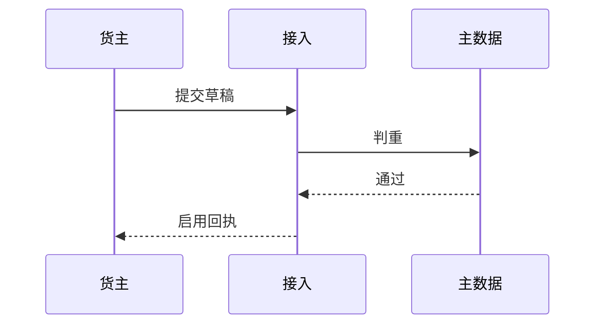

# 设计文档写作规范

本文件是参考资料，供编写 `humandesign/sysdesign/<当前版>/` 下的设计文档时按需查阅；`<当前版>` 按 `current-version.txt` 的指针值展开。指针未指向的版本目录一律冻结只读，不适用本规范，也不得作为写作依据。

> **版本门禁（开工必读）**：当前有效版本由 `humandesign/sysdesign/current-version.txt` 决定，本文件不写具体版本号，全库检索须显式排除指针未指向的版本目录。完整规则见 `.codebuddy/rules/version-policy/RULE.mdc`；本规范与版本门禁冲突时，以版本门禁为准。

---

## 一、结构：金字塔原理

四项要求，缺一不可：

1. **结论先行** —— 每份文档开头先给一句话结论（这份文档定住了什么），再展开论证。
2. **以上统下** —— 每一层必须是上一层的论据或分解，不允许出现与上层无关的内容。
3. **归类分组（MECE）** —— 同级要点互斥且穷尽，不能既重叠又遗漏。
4. **逻辑递进** —— 同级要点的排序必须有依据：按流程、按重要性、或按结构，不能随手排。

---

## 二、可检查的硬性条款

1. 文档第一段必须是一句话结论，**不得**以背景、目的、范围开场。
2. 二级标题必须是**判断句**或**问题**，不得是名词堆砌（固定骨架章节「结论 / 问题 / 设计 / 约束与验证」除外）。
   - 反例：`## 库存管理`
   - 正例：`## 库存状态与物理位置必须正交`
3. 每个论点下先给理由，再给细节；不得先铺陈细节再得出模糊结论。
4. 三个及以上并列要素必须用表格，不得写成段落罗列。
5. 每条规则必须写明**强制手段**（数据库约束 / 应用校验 / 定时核对），无手段的规则不写。
6. 单份文档只回答一个核心问题；越界内容移入对应文档并注明编号。
7. 跨文档引用用编号（如 `见 00 D28`），**不复制内容**。
8. 禁止叙事化表达（「我们先讨论了…后来改为…」），决策演进一律进 `log.md`。
9. 禁止空话式表述（「提升效率」「保证质量」），一切结论必须可验证。
10. 正文一律用中文，不夹杂英文。英文只在必须说的时候用，限于代码、表名、字段名、技术栈名称、文档编号引用。业务术语只写中文，不给英文对照——写「货主」，不写「货主 Owner」。
11. 图示必须按表达对象选型：时序状态与界面交互用时序图，状态迁移用状态图，步骤流转用流程图，结构组成用结构图；每张图须标编号、标题与一句读图要点，并用围栏代码块呈现。选型判定与呈现要求见第三节。

---

## 三、图示按表达对象选型

图的类型由「要表达什么」决定，不由画起来顺手决定。表达对象有四类，互斥且穷尽：多方消息往来、单对象状态变化、步骤流转、静态结构。选错图比不画图更伤——时序画成流程会丢掉参与方，状态画成流程会丢掉迁移条件。

### 3.1 选型判定表

| 要表达什么 | 选用图 | 判定问句 |
|---|---|---|
| 多方之间的时序状态、消息往来、界面操作交互 | 时序图 | 是否要看出「谁先谁后、谁等谁、谁回什么」？ |
| 单个对象在有限状态之间迁移 | 状态图 | 是否要看出「哪几个态、谁能转、转换条件是什么」？ |
| 一件事的步骤、分支与汇聚 | 流程图 | 是否要看出「先做什么、判断往哪走、在哪合流」？ |
| 模块、上下文、对象的组成与依赖 | 结构图 | 是否要看出「由什么组成、谁依赖谁」？ |

**时序状态与界面交互优先时序图的判定**：只要涉及两个及以上参与方、且动作有先后或等待返回，一律时序图。界面操作交互指用户动作与系统响应之间的往返（提交、校验反馈、异步回执、异常分支），不是单张页面的控件摆放——后者属于界面规格，用文字与表格，不画图。

### 3.2 例外与禁止

1. 只有一条主线、无分支无汇聚时，用有序列表即可，不必画流程图。
2. 状态只有两个且转换唯一时，用一句话表述，不必画状态图。
3. 禁止用时序图画静态结构，禁止用流程图代替状态迁移条件；确有双重表达需要时拆成两张图，各表一件事。
4. Mermaid 语法在目标环境渲染不可用时，允许退化为 ASCII 字符图，但须同时保留编号、标题与读图要点，且 ASCII 图只用半角字符绘制。

### 3.3 Markdown 呈现要求

图示一律写在围栏代码块内，格式固定为四部分，缺一即为未完成：

1. **编号与标题**：图前一行写「图 N 标题」，N 在单份文档内从 1 递增，编号不复用；跨文档引用写「见 `26` 图 1」。
2. **一句读图要点**：标题下、代码块上写一句话，说明这张图要让人看出什么，不重复图内内容。
3. **围栏与语法**：Mermaid 图用 `mermaid` 代码块；ASCII 图用 `text` 代码块。不得把图直接贴在正文段落里，不得用行内伪图。
4. **节点文字**：图中节点、消息、状态名用中文，与正文用词一致；图中出现的编号须与权威文档相同，不在图内另造编号。
5. **自包含**：每张图脱离上下文能被单独读懂——参与方、起点、终点、方向齐全，不依赖读者先看前一段。

示例：

图 1 商品档案提交时序

下图说明货主提交草稿后，系统在判重通过前不启用档案。

---

## 四、文档骨架

每份设计文档固定四段，顺序不得调整：

| 段 | 内容 |
|---|---|
| 结论 | 一段话，说清这份文档定住了什么 |
| 问题 | 这份文档解决什么、**明确不解决什么** |
| 设计 | 主体，按金字塔展开 |
| 约束与验证 | 强制手段、边界、对 `00-决策字典.md` 的引用 |

---

## 五、示例

反例：

> ## 库存管理
> 我们讨论了库存怎么管，最后觉得状态和位置要分开处理，这样比较灵活。

正例：

> ## 库存状态与物理位置必须正交
> 冻结只改状态不搬货，隔离只搬货不改状态。两者是独立操作，分别留痕。
>
> | 业务语义 | 表达方式 |
> |---|---|
> | 冻结 | 只改 `stock_status`，位置不动 |

---

## 六、规则分工

| 资料来源 | 管什么 |
|---|---|
| `.codebuddy/rules/version-policy/RULE.mdc` | 当前有效版本指针、归档版本只读禁令、过渡期回查规则（优先级最高） |
| `.codebuddy/references/写作规范.md` | `humandesign/sysdesign/<当前版>/` 设计文档的写作与结构 |
| `openspec/config.yaml` | `openspec/` 下规格变更文档的结构（前端 / 后端 / API 三章） |
| `humandesign/sysdesign/<当前版>/00-决策字典.md` | 决策内容的权威源，冲突时以它为准 |
| `humandesign/sysdesign/<当前版>/00a-红线与不变量.md` | 红线与不变量的权威源 |
| `humandesign/sysdesign/<当前版>/log.md` | 文档变更与决策推翻的追溯记录 |

四套资料用途不同，不互相覆盖：版本门禁管「用哪一套文档」，写作规范管「怎么写」，OpenSpec 管「一次变更要交付什么」，决策字典与红线管「已经定了什么」。
