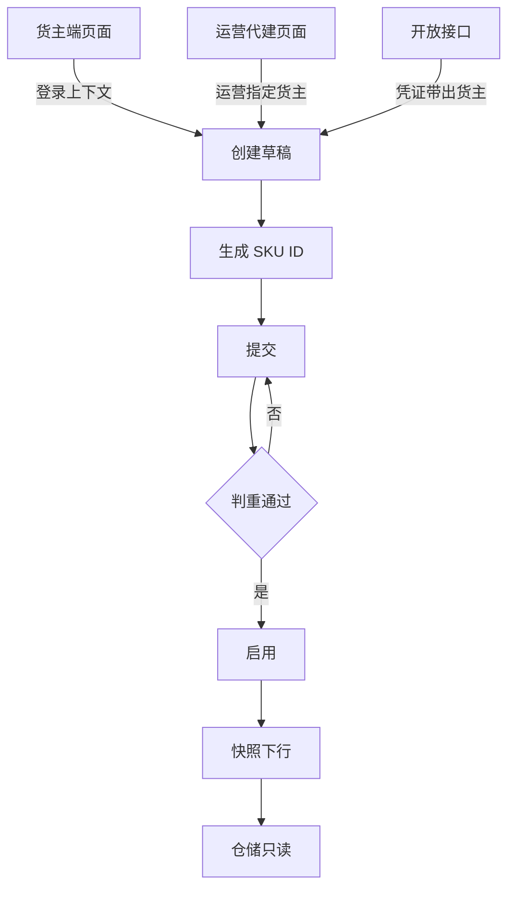
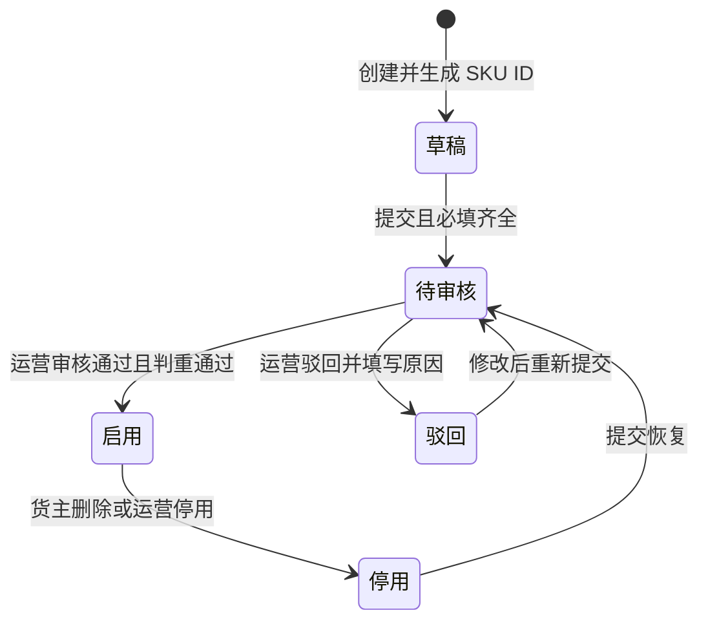
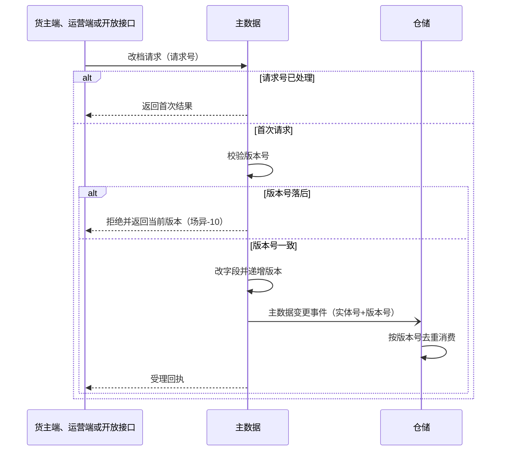

# 商品档案

## 1 结论

商品档案归货主所有，是最小库存单位（SKU），一个商品档案只属于一个货主；档案由货主端、运营代建、开放接口三种入口创建，创建即生成系统编号，经草稿态提交后启用，停用后可重新启用；组合装是独立档案，组成关系留在加工侧，不进档案本身。

## 2 问题与范围

**解决**：档案归谁、谁能建、建的时候填什么、哪些字段系统定哪些货主填、同码不同货主怎么判、草稿到启用怎么走、停用怎么回、组合装怎么落、重复提交与各类偏离怎么出口。

**不解决**：批次属性与货品作业要求（属货品层，另定）；加工动作与组成关系平衡校验（见 `09`）；库存、扫码、计费怎么用档案（见 `04`、`16`、`08`）；接口路径与错误码（见变更的接口契约章）；保管条件的温区取值全集（见 `21`，本文件不另造）。

---

## 3 设计

### 3.1 档案归货主，三种入口带入归属

归属货主是档案的必填身份，不可变更。三种入口带入方式不同，但落到档案上是同一条规则。

| 入口 | 归属怎么来 | 默认状态 |
|---|---|---|
| 货主端 | 登录上下文带入 | 草稿 |
| 运营代建 | 运营指定归属货主，必填 | 草稿 |
| 开放接口 | 凭证校验出的货主身份带入 | 草稿 |

图 1 三种入口带入归属后合流建档

下图说明三种入口各自带入归属，都先建草稿，提交判重后才启用并下行。

三条入口都先建草稿，提交时才判重和启用。运营代建的草稿只有创建的运营看得到；货主端和开放接口建的草稿只有该货主看得到，运营不关注也不展示。

### 3.2 字段分系统生成、货主必填、附属三类

同一条档案的字段按谁来定值分组，避免把系统事实与货主填写混在一起。

**系统生成（7 项，货主不填）**

| 字段 | 定值方式 |
|---|---|
| SKU ID | 创建草稿时生成，全局唯一，不随提交改变 |
| 归属货主 | 按 3.1 三入口带入，创建后不可改 |
| 版本号 | 每次改档递增，下行去重依据 |
| 创建时间、更新时间 | 系统记录 |
| 状态 | 取 3.4 的五态之一 |
| 生效时间 | 提交启用时记，草稿态为空 |

**货主必填（5 项，缺一不可提交）**

| 字段 | 规则 |
|---|---|
| 货主系统编码 | 货主自己系统里的编码，货主内唯一 |
| 名称 | |
| 条码 | 至少一个，货主内唯一 |
| 基本单位 | 库存计量最小单位 |
| 保管条件 | 取库区温区值（D46），取值由 `21` 统一登记 |

**附属（18 项，按性质分五类）**

| 类别 | 字段 |
|---|---|
| 标识扩展 | 条码类型、规格型号、品牌、品类、商品图片 |
| 计量包装 | 包装规格、包装换算率、净重、毛重、体积、长宽高 |
| 保管扩展 | 高值标记、危化标记、易碎标记 |
| 追溯控制 | 是否管批次、是否管序列号、标准保质期 |
| 生命周期 | 备注 |

包装换算率在有包装规格时必填，库位占用核算要用（见 `04`）。追溯控制只放开关和标准值，不放批次的 specific 属性——那属货品层。

### 3.3 判重按货主内唯一，幂等按请求去重

判重与幂等管的是两件事，键不同，不能互替。

| 机制 | 键 | 作用域 | 冲突表现 |
|---|---|---|---|
| 判重 | 货主系统编码、条码 | 货主内 | 提交时拒绝，退回草稿 |
| 幂等（页面） | 请求号 | 单次提交 | 第二次返回首次结果 |
| 幂等（接口） | 外部单号 | 入口去重（D21） | 重复推送不重复建档 |

判重口径：同一货主内两个 SKU 的货主系统编码或条码相同，拒绝提交；不同货主填同一个编码或条码，合法放行。判重放在提交环节，草稿态允许重复——货主可能正在改，草稿阶段拦住没有意义。

### 3.4 档案有五态，启用前必须经过审核

档案状态登记在 `22` 的 S-08，五态互斥，转换闭合。

| 状态 | 含义 | 允许动作 |
|---|---|---|
| 草稿 | 未定稿，不进任何业务链路 | 编辑、提交 |
| 待审核 | 已提交，等待运营审核 | 审核通过、驳回 |
| 驳回 | 审核未通过，保留原因 | 编辑后重新提交 |
| 启用 | 已生效，可被单据与库存引用 | 停用、发起字段变更 |
| 停用 | 不再接新入库与新出库，仅供存量走完与货主取回库存 | 提交恢复 |

图 2 商品档案的五态迁移

下图说明档案从草稿经审核进入启用，驳回可修改重提，停用可提交恢复；审核通过是动作，不另设持久态。

禁止的转换：草稿直接启用、驳回直接启用、停用态直接改档、跳过审核直接下行。删除按逻辑停用表达，不物理删除，历史单据与库存流水仍可按系统编号追溯。草稿与驳回态不下行到仓储，不进库存、扫码、单据、计费任何链路。

### 3.4a 审核与单仓变更申请

运营端是唯一审核入口，审核对象包括货主提交的档案与单仓发起的字段变更申请。单仓端对主数据字段只读，只能对本仓可见的生效档案发起变更申请；申请通过后运营写回权威档案、递增版本并下行，驳回时保留原因。库位关联不属于商品档案，库位与库存关系仍归 `04`。

**停用的准入不是全面拦截**：停用只阻断新接的入库与新接的出库，不阻断三件事——存量单据走完、仓内作业继续、货主取回剩余库存。停用态的档案仍是库存台账上的合法 SKU，库存查询与货主取回按该 SKU 发起，只有「新接的普通入库单、普通出库单」被拒绝。这个白名单由单据受理环节校验，不靠删档案或改库存实现。

### 3.5 组合装是独立档案，组成关系在加工侧

组合装的套装是独立 SKU 档案，按本文同一套字段与状态走，不另造字段。组成关系只有「套装 SKU、子件 SKU、用量」三项，落在加工模块的 `wms_bom_single`（见 `09`、`11`），属单层，不做多层嵌套。档案表与组成关系表分开建，不捆在一个表单里。

套装与全部子件必须同货主——不同货主的子件凑套装会破坏货主隔离（R-01），建组成关系时校验，不一致即拒绝。

### 3.6 场景按四类登记

场景编号接 `25` 现有序列。每条场景的六要素为触发条件、步骤、连带动作、不可逆点、对账手段、幂等键。

**正向场景**

| 编号 | 场景 | 触发与步骤 | 连带动作 | 不可逆点 | 对账手段 | 幂等键 |
|---|---|---|---|---|---|---|
| 场正-19 | 货主端建草稿 | 已登录 → 填必填五项 → 选填附属 → 存草稿 | 生成 SKU ID，状态草稿 | 无 | 草稿数与创建记录比对 | 请求号 |
| 场正-20 | 提交草稿启用 | 草稿态 → 提交 → 判重 → 启用 → 下行 | 记生效时间，版本递增 | 启用后不可回草稿 | 草稿清单与启用档案比对 | 请求号 |
| 场正-21 | 运营代建草稿 | 运营选货主 → 填字段 → 存草稿 | 仅创建运营可见 | 无 | 代建记录与草稿数比对 | 请求号 |
| 场正-22 | 开放接口建草稿 | 凭证通过 → 防腐层转换 → 建草稿 → 回执 | 生成 SKU ID，归属从凭证带出 | 无 | 外部单号与草稿号对账 | 外部单号 |
| 场正-23 | 开放接口提交 | 草稿态 → 提交 → 判重 → 启用 → 回执 | 记生效时间，版本递增 | 启用后不可回草稿 | 回执与启用档案比对 | 外部单号 |
| 场正-24 | 改档 | 启用态 → 改字段 → 校验版本 → 版本递增 → 下行 | 快照下行，仓储只读 | 改档以新版本为准 | 版本号与变更记录逐条比对 | 请求号 |
| 场正-25 | 停用与启用 | 启用态 → 停用；停用态 → 启用 | 版本递增，下行 | 停用不自动恢复 | 状态与版本号对账 | 请求号 |
| 场正-26 | 货主取回库存 | 档案停用且该 SKU 仍有在库量，货主发起取回 | 建一张出库单，类型为货主取回，按存量单据链路执行，库存减少；不冲原入库 | 出库完成不可回退，复核前可取消 | 取回出库单与该 SKU 在库量逐笔对账 | 请求号 |

**逆向场景（归 `25` 第一组主数据）**

| 编号 | 场景 | 触发与前置 | 连带动作 | 不可逆点 | 对账手段 |
|---|---|---|---|---|---|
| 场逆-17 | 草稿丢弃 | 草稿态，创建方发起 | 记录不留存 | 丢弃后不可恢复 | 创建记录与存量草稿比对 |
| 场逆-18 | 档案停用 | 启用态，货主或运营发起 | 阻断新接入库与新接出库；存量单据、仓内作业、货主取回库存继续 | 停用不自动恢复，重开需留痕 | 扫描停用档案是否被新接普通单据引用；取回单与剩余在库量对账 |

改档没有单独逆向——改回去本身是一次改档，靠版本号和留痕追溯。

**异常场景**

| 编号 | 触发环节 | 典型情况 | 出口 |
|---|---|---|---|
| 场异-07 | 提交判重 | 货主内编码或条码重复 | 拒绝提交，退回草稿；跨货主重复放行 |
| 场异-08 | 必填校验 | 必填项为空就提交 | 拒绝提交，指出缺失字段 |
| 场异-09 | 开放接口 | 外部字段不合内部模型、外部单号重复 | 防腐层拒绝，不进内部模型；单号重复按幂等返回 |
| 场异-10 | 并发改档 | 版本号落后，档案已被改过 | 拒绝并返回当前版本，重取后重试，不静默覆盖 |
| 场异-11 | 停用态受理 | 对停用档案发起新接入库单或普通出库单 | 受理拒绝，提示档案已停用；存量单据与货主取回单放行 |

**幂等场景**

| 编号 | 情形 | 幂等键 | 预期表现 |
|---|---|---|---|
| 场幂-04 | 页面重复提交创建或改档 | 请求号 | 第二次返回首次结果，不生成第二个档案 |
| 场幂-05 | 开放接口重复推送 | 外部单号 | 按单号去重，重复推送不重复建档 |

图 3 改档请求的版本校验与快照下行时序

下图说明调用方、主数据与仓储三方的消息先后：先按请求号去重，再校验版本，通过后改档并经事件下行到仓储只读快照。

---

## 4 约束与验证

| 约束 | 强制手段 | 依据 |
|---|---|---|
| 档案必属一个货主 | 数据库 `owner_id` 非空；仓储层统一注入货主条件 | R-01、INV-06 |
| 归属创建后不可改 | 更新接口不接受归属字段 | 3.1 |
| 货主内编码与条码唯一 | 数据库唯一键含 `owner_id`；提交时判重 | 3.3 |
| 状态词只用五态 | 状态值域由 `22` S-08 约束 | 3.4 |
| 草稿不进业务链路 | 库存、单据、计费查询只取启用态与停用态档案，草稿一律排除 | 3.4 |
| 停用只拦新接单据 | 受理环节按单据类型校验：新接入库与普通出库拒绝；存量单据、仓内作业、货主取回单放行 | 3.4、场异-11 |
| 停用态仍可清库存 | 货主取回建出库单且类型为货主取回，按存量单据链路执行，不冲原入库；库存流水照常留痕 | 场正-26、INV-09 |
| 套装子件同货主 | 建组成关系时校验货主一致，不一致拒绝 | R-01、3.5 |
| 组合关系只有一层 | 套装 SKU 不得作为子件出现在另一条组成关系 | `09` |
| 必填项不齐不得提交 | 应用层提交校验非空 | 3.2 |
| 改档不覆盖他人结果 | 乐观锁版本号，冲突返回当前版本 | 3.6、场异-10 |
| 幂等做在入口 | 请求号与外部单号在入口去重 | D21 |

---

## 5 引用与权威源

- 本文件是商品档案归属、字段、判重、状态转换、组合装挂法与场景的唯一权威源，其他文档只引用不改写。
- 状态词 S-08 登记在 `22`；归属隔离依据 `00a` R-01、INV-06；模块与表见 `03`、`11`；组合关系平衡见 `09`；场景编号族接 `25`。
- 引用的本版文档：`00`（D21、D46）、`00a`、`03`、`04`、`08`、`09`、`11`、`16`、`21`、`22`、`25`。
- 温区取值全集未在 `21` 登记，作为待定项见 `23`。
