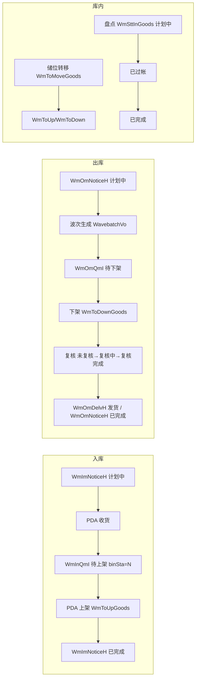
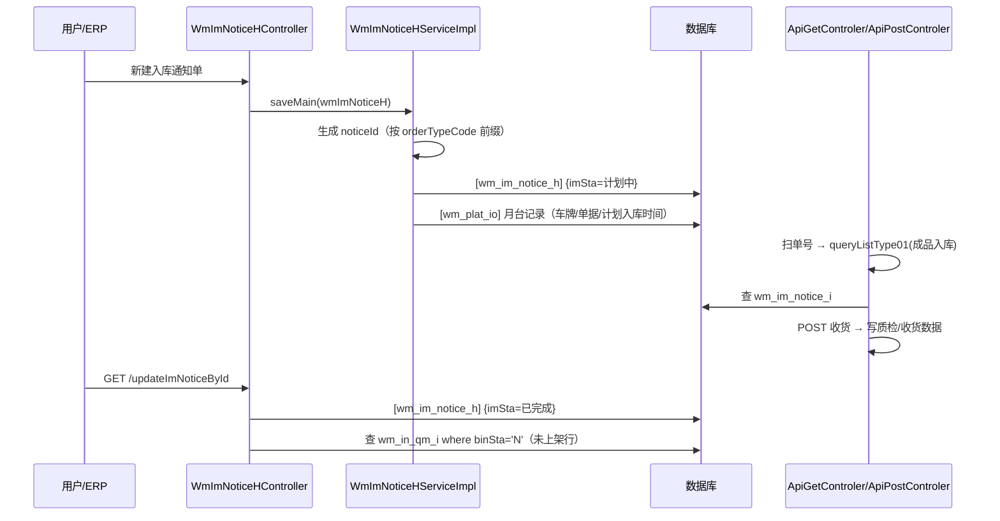
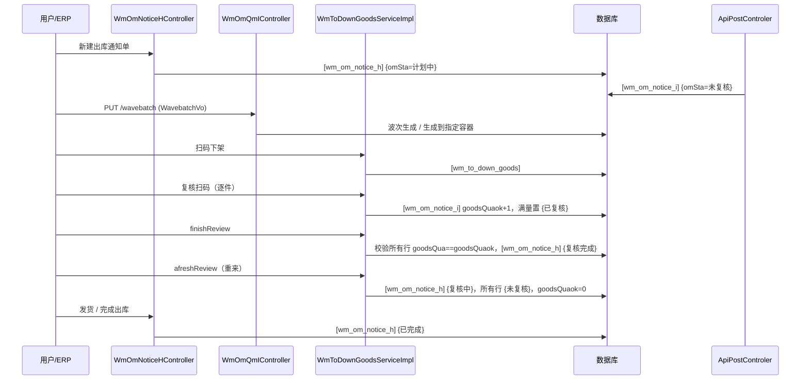

# 02a JeeWMS 功能流程（流程级）

> 配套报告：[02-jeewms.md](./02-jeewms.md)。本文件只写"一个动作如何驱动下一个对象"，每条指到类名与方法名。取证时间 2026-11-24。
>
> 图例：`[表]` 落库、`{状态}` 状态变化、`→` 触发下一步。

## 1. 追到的链路与断点

| 链路 | 追到的程度 | 断点 |
|---|---|---|
| 入库：通知单 → 收货 → 上架 | **完整**：收货 = 按箱写 `wm_in_qm_i`（托盘号/批次/生产日期/计划库位），单头状态不动 | 无（散件余数未生成实物行，属代码缺陷，非取证缺口） |
| 出库：通知单 → 波次 → 下架 → 复核 → 发货 | **完整**：波次实现已读（写行字段）、下架 8 步已读、复核三字段计数已读、发货单确认为手工 CRUD | 库存扣减已定位：不在 Java 层，由存储过程 `update_wm_his_stock` 维护（见第 8 节） |
| 移库 / 储位转移 | PDA 分支完整（写 `WmToMoveGoods`，`orderTypeCode=CWZY`） | 库存扣减时机未追 |
| 盘点 | 状态链完整（计划中 → 已过帐 → 已完成） | 盘点明细与库存差异处理未追 |
| 计费 | 只确认类与表存在 | 单据 → 费用生成链路未追 |

前置说明：本项目**没有建表 DDL**（只有 Navicat `.nb3` 备份），所以下面的表名来自实体类与 `database/WMS初始化SQL，特别谨慎使用.txt` 中的 delete 清单，字段名来自实体类。

## 2. 单据生命周期总览



## 3. 入库流程

### 3.1 时序



### 3.2 逐步对照

| # | 动作 | 代码位置 | 落库 | 状态 |
|---|---|---|---|---|
| 1 | 新建入库通知单 | `controller/WmImNoticeHController` → `service/impl/WmImNoticeHServiceImpl.java:156` | `wm_im_notice_h`、`wm_im_notice_i` | `imSta = 计划中` |
| 2 | 单号生成（按类型） | `WmImNoticeHServiceImpl` 140-155（`orderTypeCode` 分支拼前缀，如 `QTRK`、`QT`） | — | — |
| 3 | 建月台记录 | `WmImNoticeHServiceImpl` 170-180 | `wm_plat_io`（`carno`、`docId`、`planIndata`） | — |
| 4 | PDA 收货 | `pdaapi/ApiGetControler` 分支 `CONSTANTTYPE.listtype01`（成品入库）等 | 收货/质检表 | 不改单头状态 |
| 5 | 入库完成 | `WmImNoticeHController:372 updateImNoticeById`（`GET`） | `wm_im_notice_h` | `imSta = 已完成` |
| 6 | 上架记录生成 | `pdaapi/ApiGetControler:76 / :303`、`WmImNoticeHController:551 / :579` 构造 `WmToUpGoods` | `wm_to_up_goods` | 由明细 `binSta` 标记 |

### 3.3 关键设计（三处可复用的做法）

1. **入库完成 = 收货完成，不等于上架完成**。`updateImNoticeById` 只置单头"已完成"，随后查 `wm_in_qm_i` 中 `binSta='N'` 的行——上架进度用**明细行上的 `binSta`**表示，不用单头状态。【实证】
2. **库位推荐靠历史记录**：查询入库明细时，用该商品最近一条 `wm_to_up_goods` 的 `kuWeiBianMa` 回填 `binPlan`（计划库位）。即"上次放哪，这次建议放哪"。【实证 `WmImNoticeHController` 的 `queryWmImNoticeIByMainId`】
3. **月台（`wm_plat_io`）与入库单同时创建**，记录车牌、单据、计划入库时间——收货预约是在建单时落地的，不是收货时。【实证】

### 3.4 收货分支到底写了什么（W-05 已解）

【实证】`pdaapi/ApiPostControler.java:127-222`，`listtype01`（成品入库/收货）两个分支：

**A. `project == "PLTN"`（按箱收货）**

```java
if (new BigDecimal(query15).compareTo(new BigDecimal(query08)) == 1)
    throw new JeecgBootException("本次入库数量小于箱数");     // query15=每箱数, query08=总数量

BigDecimal remainder = query08.divideAndRemainder(query15)[1];  // 余数
BigDecimal sub       = query08 - remainder;                     // 整箱部分
String     div       = sub / query15;                           // 箱数

for (int i = 0; i < divs; i++) {
    WmImNoticeI wmImNoticeI = 复制原行;
    wmImNoticeI.setTinId(System.currentTimeMillis());  Thread.sleep(3);  // 托盘号=时间戳
    wmImNoticeI.setTinLength/Width/High/Weight(query17-20);
    wmImNoticeI.setBinPlan(query07 逗号后);            // 计划库位
    wmImNoticeI.setGoodsQmCount(query15);              // 合格数=每箱数
    wmImNoticeI.setGoodsWqmCount(query15);
    wmImNoticeI.setShenqingsl(query15);
    wmImNoticeI.setTuoNum(query15);
    wmImNoticeI.setGoodsBatch(query06);                // 批次
    wmImNoticeI.setGoodsPrdData(new Date());           // 生产日期
    list.add(...);
}
wmInQmIService.batchAdd(list);         // ← 真正的落库：wm_in_qm_i
executor.execute(() -> smsSend.labelPrinting(...));  // 异步打箱唛
```

**B. 非 PLTN（整单收货）**

```java
wmImNoticeI.setTinId("A");
wmImNoticeI.setGoodsQmCount(query08);   // 数量=本次收货量
wmImNoticeI.setBinPlan(query07 逗号后);
wmInQmIService.batchAdd(list);          // 同样写 wm_in_qm_i
```

结论三条：

1. **收货 = 在 `wm_in_qm_i` 里按箱生成实物行**（一箱一行，带托盘号、箱唛、计划库位、批次、生产日期），单头 `im_sta` 完全不动。
2. **数量不累加，是覆盖写**：`goodsQmCount` 等直接等于本次数量或每箱数，不是 `+`。同一行重复收货会覆盖而不是累加。
3. **散件可能丢失**：`div` 只取整箱数，循环只跑 `divs` 次，**余数部分（`remainder`）没有生成任何实物行**。除非箱唛打印环节补了散件，否则这批货不会出现在 `wm_in_qm_i` 里。【实证代码逻辑；未运行验证】

### 3.5 状态断点

- `wm_sta2="操作中"` 在 `ConstUtil` 与 `WmImNoticeHServiceImpl` 中都有定义，但 `grep` 只命中定义行，**未发现任何调用点** → 入库单实际只有"计划中 / 已完成"两个状态在用。【实证】

## 4. 出库流程

### 4.1 时序（复核段最完整）



### 4.2 逐步对照

| # | 动作 | 代码位置 | 落库 | 状态 |
|---|---|---|---|---|
| 1 | 新建出库通知单 | `WmOmNoticeHServiceImpl:113 / 176 / 227` | `wm_om_notice_h`、`wm_om_notice_i` | 单头 `ConstUtil.wm_sta1`（计划中） |
| 2 | PDA 生成出库单 | `pdaapi/ApiPostControler:514 / 540` | 同上 | 单头 `计划中`、明细 `未复核` |
| 3 | 波次生成 | `WmOmQmIController:212` → `WmOmQmIServiceImpl:434 wavebatch` | **只更新 `wm_om_qm_i`**：`wave_id = "BC"+时间戳`、`bin_sta = "N"`、`first_rq` | — |
| 4 | 生成到指定容器 | 同 Controller 注释"波次生成和波次生成到指定容器" | — | — |
| 5 | 批量下架 | `WmOmQmIController:488`（注释"下架功能-波次批量下架"）、`WaveToDownController` | `wm_to_down_goods` | — |
| 6 | 逐件复核 | `WmToDownGoodsServiceImpl:186-201`（`review` 类方法） | `wm_om_notice_i`：`goodsQuaok` 自增 | 满量时该行 `已复核`；重复扫报"已复核完成" |
| 7 | 完成复核 | `WmToDownGoodsServiceImpl:209 finishReview` | 校验所有行 | 单头 `复核完成`；不齐报"应收数量和实收数量不相等" |
| 8 | 重新复核 | `WmToDownGoodsServiceImpl:224 afreshReview` | 所有行 `goodsQuaok=0` | 单头 `复核中`，行 `未复核` |
| 9 | 出库完成 | `WmOmNoticeHController:605 / 634`、`WmImportDataController:317` | `wm_om_notice_h` | `已完成`（另有 `WmOmNoticeHServiceImpl:653` 置 `完成`） |

### 4.3 复核的实质：三字段计数

出库复核不是"状态开关"，而是**数量对齐**：

```
wm_om_notice_i.goods_qua      应收数量
wm_om_notice_i.goods_quaok    已复核数量（每扫一件 +1）
wm_om_notice_i.om_sta         未复核 / 已复核
```

`finishReview` 逐行比较 `goodsQua == goodsQuaok`，全部相等才允许单头"复核完成"。【实证 `WmToDownGoodsServiceImpl:209-223`】

这是整份文档里最值得抄的一段：**用数量字段驱动状态，而不是先置状态再补数量**。

### 4.4 波次的实现方式（方法体已读，结论改变）

【实证】`service/impl/WmOmQmIServiceImpl.java:434-460`，方法体全文逻辑：

```java
public Result<?> wavebatch(WavebatchVo vo) {
    synchronized (this) {                                  // 单机方法锁
        String firstContainer = vo.getFirstRq();
        String waveId = DateUtils.date2Str(DateUtils.yyyymmddhhmmss.get());
        int eer = vo.getIds().size();
        for (String id : vo.getIds()) {
            WmOmQmI en = wmOmQmIMapper.selectById(id);
            en.setWaveId("BC" + waveId);                   // 波次号 = "BC" + 时间戳
            en.setBinSta("N");                             // 待下架
            if (StringUtils.isNotEmpty(firstContainer)) {
                en.setFirstRq(firstContainer);             // 首容器
            }
            eer -= wmOmQmIMapper.updateById(en);
        }
        return eer == 0 ? Result.ok("任务确认成功") : Result.ok("任务确认失败" + eer + "条");
    }
}
```

三个结论：

1. **波次不是独立对象**：没有波次表，波次只是 `wm_om_qm_i` 行上的三个字段——`wave_id`（"BC"+时间戳）、`bin_sta`（置 `N`）、`first_rq`（首容器）。
2. **一次调用 = 一个波次**：`waveId` 在循环外生成一次，本次传入的所有 `ids` 共用一个波次号。
3. **并发控制是 `synchronized (this)`**：JVM 内方法锁，多实例部署时失效。

这印证了 4.2 表格第 3 行"波次生成"的判断，也说明它和 Open WES 的波次模型（独立表 `w_outbound_wave` + 状态机）不是一个量级。

### 4.5 发货单：没有自动生成逻辑（结论已确认）

【实证】

- `service/impl/WmOmDelvHServiceImpl.java` 全文 **19 行**，只是 `extends ServiceImpl<WmOmDelvHMapper, WmOmDelvH>`，无业务方法。
- `controller/WmOmDelvHController.java` 只有标准 CRUD：`/list`、`/add`、`/edit`、`/delete`、`/deleteBatch`、`/queryById`，其中 `/add` 就是 `wmOmDelvHService.save(wmOmDelvH)`。
- 全仓 `new WmOmDelvH()` 零命中。

结论：**发货单靠手工新增或外部调用 `/add` 传入，系统内没有"复核完成 → 自动生成发货单"的链路**。

### 4.6 下架流程（方法体已读）

【实证】`WmOmQmIServiceImpl.java:495-545 pdaDotowavedown(List<WmOmQmI>, String binSta)`：

| 步骤 | 动作 | 失败处理 |
|---|---|---|
| 1 | 校验 `binId`（库位）非空 | 抛"库位不能为空" |
| 2 | 校验 `tinId`（托盘）非空 | 抛"托盘不能为空" |
| 3 | 回写 `binId` / `tinId` / `qmOkQuat`（本次下架量） | — |
| 4 | 扣减出库通知行的 `waitQua`（待下架量）：`wait > qua` 才减 | 不足则不动 |
| 5 | 查库存 `WvStock`（按 `binId + tinId + goodsId`） | 无记录抛"没有商品库存" |
| 6 | 校验下架量 ≤ 库存量 | 超量抛"商品库存不足" |
| 7 | 置 `binSta = 传入值`（N / Y） | — |
| 8 | 插入下架记录 `WmToDownGoods` | — |

**关键事实**：第 5、6 步只做库存**校验**，没有扣减库存的 update 语句；`binSta` 由调用方传入（`N` 或 `Y`），不是系统算出来的。库位也是 PDA 扫码传入的 `binId`，**系统不做库位选择**（没有先进先出/批次策略）。

库存扣减发生在哪一步，本次仍未追到 →【未核实】。

## 5. 移库 / 储位转移

【实证】`pdaapi/ApiPostControler:390 / 427 / 477`：

```
构造 WmToMoveGoods，orderTypeCode = "CWZY"（储位转移）
同时把来源 wm_om_qm_i.binSta 置 "N"
```

其他移库相关入口：`WmToMoveGoodsController`。

### 5.1 `bin_sta` 的取值（全仓统计）

【实证】`grep -rhoE 'setBinSta\("[A-Z]"\)'` 全仓统计：

| 值 | 出现次数 | 语义（从上下文读，未在代码中定义） |
|---|---|---|
| `Y` | 18 | 已完成（已上架 / 已下架） |
| `N` | 8 | 待处理（待上架 / 待下架） |
| `I` | 4 | **拆托**（`listtype07`）：置 `I`，`binId` 改为 `"CTQ"`，`omQuat="0"`，同时生成储位转移记录 |
| `H` | 1 | **销售出库**（`listtype06`）：置 `H`，写入 `omQuat`（出库数量） |

代码里**没有 `bin_sta` 的枚举或常量类**，四个值全是字面量散落在各处。`H`/`I` 的含义是读 `ApiPostControler` 的 `listtype06` / `listtype07` 两个分支的上下文得出的（【实证】第 464-476 行）。注意 `I` 分支把库位直接写死成 `"CTQ"`（疑似"拆托区"），属于硬编码业务规则。

## 6. 盘点流程

```
WvStockSttServiceImpl 生成盘点单  → {计划中}
WmSttInGoodsServiceImpl 过账      → {已过帐}
WmSttInGoodsController / ApiPost  → {已完成}
```

【实证】

- 生成：`service/impl/WvStockSttServiceImpl.java:98 / :154` 置 `计划中`
- 过账：`service/impl/WmSttInGoodsServiceImpl.java:112 / :138 / :148` 置 `已过帐`
- 完成：`controller/WmSttInGoodsController.java:131`、`pdaapi/ApiPostControler.java:684 / :698` 置 `已完成`
- 另有 `WmSttInGoodsServiceImpl:175` 返回文案"盘点完成"

**断点**：明盘/暗盘的差异（PDA `listtype11/12`）在服务端如何区分未追 →【未核实】。

## 7. PDA 的十个动作如何落到代码

`controller/WmsPdaController.java:62` 的注释是业务清单，实际分派在 `pdaapi/ApiGetControler`（28 个 `listtype.equals` 分支，查询）与 `pdaapi/ApiPostControler`（23 个分支，提交）。

| PDA 动作 | 分派方式 | 代码位置 |
|---|---|---|
| 验收 / 采购入库 | `listtype03` 等分支 | `ApiGetControler` 查询 + `ApiPostControler` 提交 |
| 上架 | 构造 `WmToUpGoods` | `ApiGetControler:76 / :303` |
| 按单拣货 / 销售出库 | `listtype06` 等分支 | 同上 |
| 复核 | 数量自增 + 行状态 | `WmToDownGoodsServiceImpl:186` |
| 波次下架 | `WaveToDownController` / `WmOmQmIController:488` | — |
| 波次分拣 | `listtype22` 等 | `ApiGetControler` |
| 储位转移 | `WmToMoveGoods`，`CWZY` | `ApiPostControler:390` |
| 库存查询 | `listtype14 / listtype25` | `ApiGetControler` |
| 边拣边分 | PDA 分支（未定位到具体 type） | 【未核实】 |
| 商品查询 | `listtype24` | `ApiGetControler` |

## 8. 库存是怎么维护的：不在 Java 里（本次最重要发现）

追"库存扣减语句"追到最后，结论是：**Java 代码里没有库存扣减**。

### 8.1 库存是视图，不是表

【实证】

- `entity/WvStock.java` 标注 `@TableName("wv_stock")`
- `mapper/xml/WvStockMapper.xml` 第 236-263 行所有语句都是 `select * from wv_stock where kuctype = '库存' ...`
- `WvStockMapper.java` 只有查询方法（`queryListType`、`selectKCByBinIdAndTindId`、`getStockByKwAndGoodsId`、`selectStockById`），**没有任何 insert/update**
- 全仓 `grep "wv_stock" --include='*.xml'` 无 update 语句

`wv_` 前缀 + 只读 + `kuctype='库存'` 过滤条件，说明它是**数据库视图**，由底层流水表汇总。视图定义不在仓库（无 DDL），无法从代码审计口径。

### 8.2 真正的维护动作：一个存储过程 + 一个定时任务

【实证】`service/impl/CostTask.java:251`：

```java
String tsql = "call update_wm_his_stock('" + datestr + "')";
try {
    jdbcTemplate.execute(tsql);
} catch (Exception e) {
    e.printStackTrace();
}
```

- 调用者：`CostTask`（`@Service("costTask")`），即日费用计算任务
- 方式：`jdbcTemplate.execute` 直接执行数据库存储过程
- 异常：只 `printStackTrace()`，**失败不报错、不中断**
- 存储过程 `update_wm_his_stock(日期)` 的 SQL 不在仓库内

### 8.3 一处疑似无效的"更新库存"

【实证】`controller/WmToUpGoodsController.java:104-113`（上架编辑）：

```java
WmInQmI wmInQmI = new WmInQmI();
wmInQmI.setGoodsId(wmToUpGoods.getGoodsId());
wmInQmI.setBaseGoodscount(wmToUpGoods.getBaseGoodscount());
wmInQmIService.updateById(wmInQmI);            // 新对象，未设置主键

WmHisStockData wmHisStockData = new WmHisStockData();
wmHisStockData.setGoodsId(wmToUpGoods.getGoodsId());
wmHisStockData.setCount(wmToUpGoods.getBaseGoodscount());
wmHisStockDataService.updateById(wmHisStockData);   // 新对象，未设置主键
```

`new` 出来的对象没有 `id` 就调 `updateById`。按 MyBatis-Plus 语义，主键为空无法定位记录（更新 0 行或抛异常）。所以这两行**在逻辑上不产生库存更新**。

这是"代码事实 + 框架语义"的推断，未运行验证 →【未核实：是否抛异常】。但足以说明：上架动作不是通过这段代码改库存的。

### 8.4 这条结论的含义

| 判断 | 依据 |
|---|---|
| 库存口径无法从代码审计 | 视图与存储过程定义都不在仓库 |
| 库存更新是"批量/按日"而非"实时逐单" | `update_wm_his_stock(日期)` 由日费用任务触发 |
| 单据与库存之间没有强一致保证 | 收货/下架只查视图、写业务记录，扣减交给存储过程 |
| 出库下架"只校验不扣减"是设计如此，不是漏写 | 与 8.2 的机制吻合 |

参考价值只剩"用视图汇总流水"这个思路，实现不可参考。

## 9. 状态字典（全部来自代码常量）

【实证】`util/ConstUtil.java:8-17`：

| 常量 | 值 | 实际使用情况 |
|---|---|---|
| `wm_sta0` | 初始化 | 未在本次 grep 到调用 |
| `wm_sta1` | 计划中 | 入库单、出库单创建时使用 |
| `wm_sta2` | 操作中 | **只找到定义，未找到调用** |
| `wm_sta3` | 已删除 | 未找到调用 |
| `wm_sta4` | 已完成 | 入库/出库完成时使用 |
| `wm_sta5` | 复核中 | `WmToDownGoodsServiceImpl:233` |
| `wm_sta6` | 复核完成 | `WmToDownGoodsServiceImpl:220` |
| `wm_sta7` | 未复核 | `WmOmNoticeHServiceImpl:294 / :373` |
| `wm_sta8` | 未拣货 | 未找到调用 |
| `wm_sta9` | 已拣货 | 未找到调用 |

**重复定义问题**：同一组常量在三个类里各定义了一份——

```
util/ConstUtil.java                       （10 个）
service/impl/WmImNoticeHServiceImpl.java:64-65  （至少 wm_sta1/wm_sta2）
service/impl/WmU8PushMessageServiceImpl.java:35 （至少 wm_sta2）
```

【实证】`grep "wm_sta2 ="` 命中 2 处、`grep "wm_sta1 ="` 命中 ConstUtil 与 ServiceImpl。这意味着**状态值没有单一事实源**，改文案时容易漏改。这是明确的"不建议参考"点。

## 10. 表 / 状态对照

| 业务对象 | 表 | 状态字段 | 取值来源 |
|---|---|---|---|
| 入库通知单 头/行 | `wm_im_notice_h` / `wm_im_notice_i` | `im_sta` | `ConstUtil`（String） |
| 入库质检 头/行 | `wm_in_qm_h` / `wm_in_qm_i` | `bin_sta`（N/Y） | 代码字面量 |
| 上架记录 | `wm_to_up` / `wm_to_up_goods` | — | — |
| 出库通知单 头/行 | `wm_om_notice_h` / `wm_om_notice_i` | `om_sta` | `ConstUtil`（String） |
| 出库质检/波次行 | `wm_om_qm_i` | `bin_sta`（N/H/I）、`om_qua` | 代码字面量 |
| 下架记录 | `wm_to_down_goods` | — | — |
| 发货单 头/行 | `wm_om_delv_h` / `wm_om_delv_i` | — | — |
| 移库记录 | `wm_to_move_goods` | `order_type_code = CWZY` | 代码字面量 |
| 盘点 | `wm_stt_in_goods` | `stt_sta` | 计划中/已过帐/已完成 |
| 库存历史 | `wm_his_stock` / `wm_his_stock_ku` / `wm_his_stock_data` | — | — |
| 月台 | `wm_plat_io` | — | — |
| 日费用 | `wm_day_cost` / `wm_day_cost_conf` | — | — |

> 字段名由实体类驼峰转下划线推断（如 `imSta` → `im_sta`），**没有 DDL 可核对**，实际列名以 `.nb3` 备份为准。【未核实】

## 11. 附：计费、明暗盘、多租户

### 11.1 计费怎么算出来的（W-15 已解）

【实证】`service/impl/CostTask.java:262 costcountrun10(String datestr)`

```
数据源：wmDayCostConfMapper.getcost10(datestr)
  SQL：select mg.cf_wen_ceng, wi.tin_id, wi.cus_code, wi.im_notice_id, wi.goods_id,
              sum(wi.qm_ok_quat)/mg.chl_shl  as qmcount,     -- 层数
              mg.zhl_kg                      as zhl_kg,      -- 单重
              sum(wi.qm_ok_quat)*mg.zhl_kg   as grcount      -- 总重
       from wm_in_qm_i wi, mv_goods mg
       where wi.goods_id = mg.goods_code and wi.qm_ok_quat > 0
         and to_days(wi.create_time) = to_days(#{costdate})

过滤：im_notice_id 以 "QT" 开头的单跳过（continue）

落库：new WmDayCost()
       setCostJs("N")           // 未结算
       setCostCode(costcode)
       setCostName(getcostname(cuscode))
       setCostData(datestr)
       setCostOri(ori) / setCostSl(costSl)
       setCostSta("已生成")
       setCreateBy("system")
```

结论三条：

1. **计费是"按日扫描实收行 × 商品主数据系数"**，不是按单据、不是按合同。系数来自 `mv_goods`（`cf_wen_ceng` 层数、`chl_shl` 每层数量、`zhl_kg` 重量）。
2. **计费与库存无关**：数据源是 `wm_in_qm_i`（入库实收），不看当前库存。
3. **状态两段**：`costSta="已生成"` + `costJs="N"`（未结算），后续结算流程未追 →【未核实】。

### 11.2 明盘与暗盘：服务端逻辑完全相同（W-16 已解）

【实证】`ApiPostControler` 的 `listtype11`（明盘）与 `listtype12`（暗盘）两个分支，逐行对比：

| | 明盘 `listtype11` | 暗盘 `listtype12` |
|---|---|---|
| 取数量字段 | `query08` | `query09` |
| 空值校验 | "请输入盘点数量！" | "请输入盘点数量！" |
| 写 `sttQua` | 是 | 是 |
| 写 `tenantId` | 是 | 是 |
| `diffQua = goodsQua - sttQua` | 是 | 是 |
| 置 `sttSta="已完成"` | 是 | 是 |

两段代码除参数名外**完全一致**。所以"明盘/暗盘"的差别只在前端是否把账面数 `goodsQua` 显示给作业员，服务端一视同仁。

顺带一个缺陷：盘点提交时直接置 `sttSta="已完成"`，而 `WmSttInGoodsServiceImpl` 里还有"已过帐"状态——正常应是 计划中 →（盘点）→ 已过帐 → 已完成，但 PDA 直接跳到已完成，**"已过帐"这条路径在 PDA 上被跳过了**。

### 11.3 多租户：字段级，无自动拦截（W-17 已解）

【实证】

- 全仓 `tenantId` / `tenant_id` 命中 **61 个 Java 文件**。
- Mapper XML 里是手写条件，例如 `WmImNoticeIMapper.xml:110`：
  ```xml
  <if test="wmImNoticeI.tenantId != null and wmImNoticeI.tenantId != ''">
      and i.tenant_id = #{wmImNoticeI.tenantId}
  </if>
  ```
- 搜索 `TenantLineHandler` / `InnerInterceptor` / `SqlParser` **零命中** → **没有 MyBatis-Plus 租户插件**。

结论：多租户是"每个查询自己记得加 tenant_id"，靠开发纪律而非框架强制。漏一处就是一个越权查询口子。这是明确的"不建议参考"点。

## 12. 未核实

1. **存储过程 `update_wm_his_stock` 的 SQL 定义**：不在仓库内，库存口径无法从代码审计。
3. `wv_stock` / `wv_stock_stt` 两个视图的定义：同样不在仓库内。
4. `WmToUpGoodsController:104-113` 空主键 `updateById` 的实际行为（抛异常还是静默 0 行）——未运行验证。
5. 计费结算：`WmDayCost.costJs="N"` 之后由谁结算、如何回写（本次只确认了"生成"环节）。
6. 所有表名与列名的最终形态（无 DDL，只能从实体与 delete 清单推断）。

> 本次已补齐并移出未核实：波次实现、发货单生成方式、下架 8 步、`bin_sta` 四个取值的语义、库存维护机制（存储过程 + 视图）、收货分支写表、计费折算、明暗盘差异、多租户实现方式。

> 本次已补齐并移出未核实：波次实现（`wavebatch` 写 `wave_id`/`bin_sta`/`first_rq`，无波次表）、发货单生成方式（无自动生成，仅 CRUD `add`）、下架 8 步流程、`bin_sta` 取值统计。
