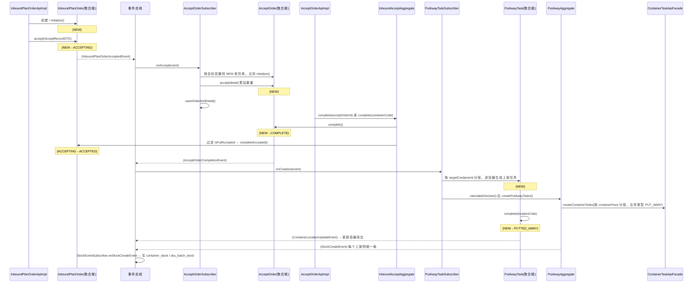
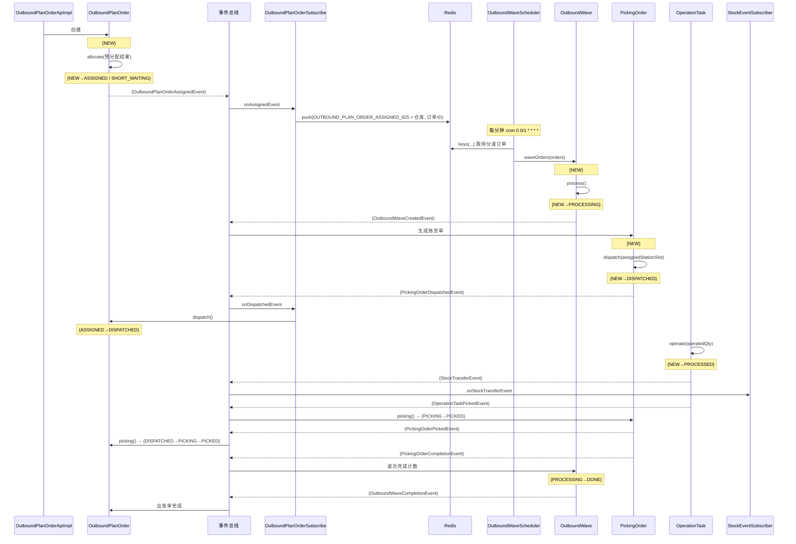

# 04a Open WES 功能流程（流程级）

> 配套报告：[04-open-wes.md](./04-open-wes.md)。本文件只写"一个动作如何驱动下一个对象"，每条都指到类名与方法名。取证时间 2026-11-24。
>
> 图例：`[表]` 落库、`{状态}` 状态变化、`(事件)` 领域事件、`→` 触发下一步。

## 1. 本次追到的链路与断点

| 链路 | 追到的程度 | 断点 |
|---|---|---|
| 入库：计划单 → 收货 → 上架 → 容器库存 | **完整**：收货 API → 聚合 → 上架任务 → 设备任务 + 库存事件 | 无 |
| 出库：计划单 → 分配 → 波次 → 拣货单 → 作业任务 → 库存扣减 | **完整**：含出库设备任务（`PickingOrderTaskAggregate`）与拣货前 SKU 锁 | 无 |
| 库存：任务完成 → 库存写入 | **完整**：四账户恒等式 + 乐观锁重试 | 无 |
| 盘点 / 调整 | **完整**：盘点→异常记录→调整单→库存事件 | 无（中间"人工建调整单"是设计，不是缺口） |
| 设备 | 上架与出库两个方向的创建点都已确认 | 回调协议未读 |

结论先说：**Open WES 的库存不是被单据直接改的，是被"作业任务完成"这个动作改的**，中间隔了一层领域事件。这是它和多数开源 WMS 最大的结构差异。

## 2. 入库流程

### 2.1 时序



**这一段是本次补齐的核心**：收货本身**不写库存**；库存由 `PutAwayAggregate` 在上架任务创建时通过 `StockCreateEvent` 写入。【实证 `PutAwayAggregate.java:71`】

### 2.2 逐步对照

| # | 动作 | 代码位置 | 落库 | 状态 | 事件 |
|---|---|---|---|---|---|
| 1 | 创建入库计划单 | `wes-inbound/.../domain/entity/InboundPlanOrder.java:64 initialize()` | `w_inbound_plan_order(+_detail)` | `NEW` | — |
| 2 | 收货一箱/一件 | 同上 `accept(AcceptRecordDTO)` | 更新明细已收数量 | `NEW→ACCEPTING`（仅首次） | `InboundPlanOrderAcceptedEvent` |
| 3 | 生成/累加收货单 | `application/event/AcceptOrderSubscriber.java:31 onAccept` | `w_accept_order(+_detail)`，按目标容器聚合，同一容器未完成的收货单复用 | — | — |
| 4 | 收货单完成（两个入口） | `application/AcceptOrderApiImpl.java:28 complete(Long acceptOrderId)` 与 `:51 complete(String containerCode)` → `InboundAcceptAggregate.complete()` | `w_accept_order` | `NEW→COMPLETE`（`AcceptOrder.java:78`） | `AcceptOrderCompletionEvent` |
| 4.1 | 同步推进入库单 | `domain/aggregate/InboundAcceptAggregate.java:38-50`：过滤 `isFullAccepted` 的单，逐张 `completeAccepted()` | `w_inbound_plan_order` | `ACCEPTING→ACCEPTED` | `InboundOrderCompletionEvent` |
| 5 | 生成上架任务 | `application/event/PutAwayTaskSubscriber.java:37 onCreation` | `w_put_away_task(+_detail)`，按 `targetContainerId` 分组，一个容器一个任务 | `NEW` | — |
| 5.1 | 计算方向 + 建设备任务 + 写库存 | `domain/aggregate/PutAwayAggregate.java:28-73 createPutAwayTasks()` | `w_put_away_task`、`e_container_task` | — | `StockCreateEvent` |
| 5.1a | 其中：建设备任务 | 同上 `:32-51`，按 `containerFace` 分组 → `containerTaskApiFacade.createContainerTasks(...)`，`businessTaskType=PUT_AWAY`、`containerTaskType=INBOUND` | `e_container_task` | — | — |
| 5.1b | 其中：写库存 | 同上 `:54-71`，每个上架明细构造 `StockCreateDTO`（`orderNo=taskNo`、`targetContainerId/Code`、`transferQty=qtyPutAway`）并发 `StockCreateEvent` | 经 `StockEventSubscriber` 写 `w_container_stock`、`w_sku_batch_stock` | — | `StockCreateEvent` |
| 6 | 上架完成 | `PutAwayTask.java:54 complete(locationCode)` | 写入 `locationCode` | `NEW→PUTTED_AWAY`，重复完成抛 `IllegalStateException` | `ContainerLocationUpdateEvent` |
| 7 | 更新容器库位 | `wes-basic/.../ContainerEventSubscriber.java:53` | `w_container`（所在库位） | — | — |

### 2.3 入库单状态机

```
NEW ──accept()──> ACCEPTING ──completeAccepted()──> ACCEPTED
 │                   │                                  ▲
 │                   └──close()──> CLOSED ──────────────┘(发 InboundOrderCompletionEvent)
 ├──cancel()──> CANCEL（仅 NEW 允许）
 └──close()───> CLOSED（仅 NEW/ACCEPTING 允许）
```

【实证】`InboundPlanOrder.java`：`close()` 对非 `NEW/ACCEPTING` 抛 `INBOUND_STATUS_ERROR`；`cancel()` 只允许 `NEW`；`completeAccepted()` 先校验 `isFullAccepted()`，全部明细完成才置 `ACCEPTED`，否则只打日志返回；另有 `forceCompleteAccepted()` 强制置完成。

### 2.4 收货单状态机

```
NEW ──complete()──> COMPLETE
 └──cancel(detailId)──> 取消（仅 NEW）
```

【实证】`AcceptOrder.java:78-92`。

### 2.5 上架任务状态机

```
NEW ──complete(locationCode)──> PUTTED_AWAY
```

【实证】`PutAwayTask.java:54-72`。

## 3. 出库流程

### 3.1 时序（含"事件 + Redis 队列 + 定时任务"的三段式）



### 3.2 逐步对照

| # | 动作 | 代码位置 | 落库 | 状态 | 事件 |
|---|---|---|---|---|---|
| 1 | 创建出库计划单 | `OutboundPlanOrder.java:72 initialize()` | `w_outbound_plan_order(+_detail)` | `NEW` | `OutboundPlanOrderCreatedEvent` |
| 2 | 预分配并判定 | `OutboundPlanOrder.java:118-152`（`allocate` 逻辑体） | `w_outbound_pre_allocated_record` | 见 3.3 | `OutboundPlanOrderAssignedEvent` |
| 3 | 待分波入队 | `OutboundPlanOrderSubscribe.java:63 onAssignedEvent` | 仅 Redis list | — | — |
| 4 | 定时分波 | `application/scheduler/OutboundWaveScheduler.java:35`（`cron="${wms.schedule.config.wavePicking:0 0/1 * * * *}"`，带 `@DistributedScheduled`） | `w_outbound_wave` | `NEW` | `OutboundWaveCreatedEvent` |
| 5 | 生成拣货单 | `OutboundWaveSubscribe.java:30 onCreateEvent` | `w_picking_order(+_detail)` | `NEW` | — |
| 6 | 派单到工作站 | `PickingOrder.java:89 dispatch(assignedStationSlot)` | 写 `workStationId` 与格口 | `NEW→DISPATCHED` | `PickingOrderDispatchedEvent` + 生命周期事件 |
| 7 | 回写出库单派单 | `OutboundPlanOrderSubscribe.java:69 onDispatchedEvent` | — | `ASSIGNED→DISPATCHED` | — |
| 8 | 作业执行 | `wes-task/.../OperationTask.java:91 operate(...)` | `w_operation_task` | `NEW→PROCESSED`（`PROCESSED/CANCELED` 再操作直接拒绝） | `StockTransferEvent`（第 229 行） |
| 9 | 拣货单累加 | `PickingOrderSubscribe.java:38 onOperationTaskPickedEvent` | — | `PICKING`；全明细 `PICKED` 时 `PICKED` | — |
| 10 | 出库单累加 | `OutboundPlanOrder.java:179 picking(...)` | — | `DISPATCHED→PICKING→PICKED` | — |
| 11 | 波次完成 | `OutboundWave.java:53 complete()` | — | `PROCESSING→DONE` | `OutboundWaveCompletionEvent` |
| 12 | 出库单收尾 | `OutboundPlanOrderSubscribe.java:101 onOutboundWaveCompletionEvent` | — | 完成 | `OutboundPlanOrderCompletionEvent` |

### 3.3 分配判定的四个分支（这段逻辑很有参考价值）

【实证】`OutboundPlanOrder.java:118-152`，按"已预分配总量 vs 需求总量"判断：

| 条件 | 结果 | 备注 |
|---|---|---|
| `totalPreAllocated == totalRequired` | `ASSIGNED` + 发 `OutboundPlanOrderAssignedEvent` | 正常路径 |
| 不足且 `shortWaiting == true` | `SHORT_WAITING` | 缺货等待，不报错 |
| 不足且 `shortOutbound == true` 且有预分配记录 | 仍 `ASSIGNED`，但 `abnormal=true`、`abnormalReason="short preAllocate"` | **欠量也放行，但打异常标记** |
| 以上都不满足 | 调 `shortComplete()` → `PICKED` | 直接短拣完成 |

### 3.4 出库单状态机

```
NEW ──allocate 足量──> ASSIGNED ──dispatch()──> DISPATCHED ──picking()──> PICKING ──全拣──> PICKED
 │                        ▲                                                    
 ├──缺货等待──> SHORT_WAITING ──补足──┘
 └──cancel()──> CANCELED（受 cancellability() 约束）
```

【实证】`OutboundPlanOrder.java` 的 `cancel()` 先调 `OutboundPlanOrderStatusEnum.cancellability(status)`，不允许则拒绝。

### 3.5 拣货单状态机（比出库单多两个异常动作）

```
NEW ──dispatch()──> DISPATCHED ──picking()──> PICKING ──全拣──> PICKED
 │                     └──cancel()──> CANCELED（仅 NEW）
 ├──reportAbnormal(abnormalQty, detailId)
 ├──reallocateAbnormal(allocatedQty, detailId)
 ├──shortPicking(shortQty, detailId)  → 全明细 PICKED 时置 PICKED
 └──allowReceive()
```

【实证】`PickingOrder.java:89-176`。

### 3.6 波次状态机

```
NEW ──process()──> PROCESSING ──complete()──> DONE
 └──cancel()──> CANCELED（DONE 不允许取消）
```

【实证】`OutboundWave.java:43-74`。

## 4. 盘点流程

```
StocktakeOrder {NEW} ──execute()──> {STARTED} ──complete()──> {DONE}
                       └──cancel()──> {CANCELED}
```

【实证】`wes-stocktake/.../StocktakeOrder.java:52-90`：`execute()` 先过 `StocktakeOrderStatusEnum.isExecutable()`，`complete()` 先过 `isFinal()`，`cancel()` 先过 `isCancelable()`。

涉及表：`w_stocktake_order(+_detail)`、`w_stocktake_task(+_detail)`、`w_stocktake_record`。

### 4.1 执行链路（W-04 已解）

【实证】`wes-stocktake/.../domain/aggregate/StocktakeAggregate.java`

```
executeStocktakeOrder(tasks, order)    生成盘点任务并保存 → {STARTED}
receiveStocktakeOrder(tasks, stationId)
    ├─ containerApi.lockContainer(仓库, 容器集合)      锁定容器（防止作业中被改）
    ├─ task.receive(workStationId)                    任务绑定工作站
    ├─ stocktakeTaskService.buildContainerTasks(...)  建设备任务（货到人取货）
    └─ saveAllTaskAndDetails(...)
submitStocktakeRecord(record, task, sku, dto, abnormalDTOs)
    ├─ record.submit(dto)                             提交盘点结果
    ├─ 若存在异常记录且（差异复核 或 qtyAbnormal != 0）→ stockAbnormalRecordApi.recheckClose(...)
    └─ 若 qtyAbnormal != 0 → createStockAbnormalRecords(一条 StockAbnormalRecord，
          type = STOCK_TAKE, qtyAbnormal, 关联 containerStockId / skuBatchStockId)
```

**关键设计：盘点差异不直接改库存**。提交盘点记录只做两件事——关闭差异复核、生成库存异常记录。库存数字一个都不动。

### 4.2 差异怎么落到库存：走调整单

【实证】

```
盘点差异 → w_stock_abnormal_record（异常记录，type=STOCK_TAKE）
         → 另建 StockAdjustmentOrder（库存调整单）
         → StockAdjustmentApiImpl.adjust(ids)
         → StockAdjustmentAggregate.adjust()
              ├─ order.adjust()                调整单置完成
              └─ 发 StockTransferEvent(ADJUST)  → StockEventSubscriber
                                                  → transferAndUnlockStock()
                                                  → SkuBatchStock 数量变化
```

`StockAdjustmentAggregate.java:41-58` 的 `adjust()` 里明确构造 `StockTransferEvent` 并把 `taskType` 设为 `OperationTaskTypeEnum.ADJUST`；库存模块收到后走"扣减并解锁"分支（见 5.3 的 `subtractAndUnlockQty`）。

所以盘点与库存之间是**两段式**：盘点只产异常，调整单才动库存。中间没有自动建单的代码——`StocktakeAggregate` 里没有创建 `StockAdjustmentOrder` 的调用。【实证：`grep StockAdjustment` 在 stocktake 模块零命中】

这条链路的完整形状：

```
盘点单 → 盘点任务 → 盘点记录 → 异常记录 ──(人工/另建)──> 调整单 → 库存事件 → 四账户变动
```

## 5. 库存写入流程（本系统最核心的机制）

### 5.1 三个事件决定三种写库方式

【实证】`wes-stock/.../application/event/StockEventSubscriber.java`：

| 事件 | 处理器 | 用途（代码注释原文） | 调用的聚合方法 |
|---|---|---|---|
| `StockCreateEvent` | `onStockCreateEvent` | "event is only available for the first time stock put into the container and the container does not exist the current sku before. Applying Scenes like: receiving" | `createStock` |
| `StockTransferEvent` | `onStockTransferEvent` | "applying scenes like: put away, piking, adjust and so on"（原文拼写 piking） | `PICKING`/`ADJUST` → `transferAndUnlockStock`；其他 → `transferStock` |
| `StockClearEvent` | `onStockClearEvent` | 清空 | — |

写完库存后统一发 `ContainerStockUpdateEvent`（容器库存变更）→ 缓存/ES 同步用。

### 5.2 事件由谁发

【实证】`grep "new Stock(Create|Transfer|Clear)Event"` 命中三处：

```
wes-inbound/.../PutAwayAggregate.java:71        ← 上架（发 StockCreateEvent）
wes-task/.../OperationTask.java:229             ← 作业任务（发 StockTransferEvent）
wes-basic/.../TransferContainer.java            ← 容器搬运
wes-stock/.../StockAdjustmentAggregate.java     ← 库存调整
```

**这条最重要**：入库上架、出库拣货、库存调整，最终都是通过 `OperationTask`（作业任务）完成 → 发库存事件 → 库存模块记账。库存模块不直接依赖入出库模块。

### 5.3 记账规则：四账户恒等式 + 不允许负库存（W-02 已解）

【实证】`wes-stock/.../domain/entity/SkuBatchStock.java`

字段五个数量 + 一个版本号：

```java
private Integer totalQty          = 0;   // 总量
private Integer availableQty      = 0;   // 可用
private Integer outboundLockedQty = 0;   // 出库锁定量
private Integer noOutboundLockedQty = 0; // 非出库锁定量
private Integer frozenQty         = 0;   // 冻结量
private Long    version;                 // 乐观锁
```

每个动作先改数、再调 `validateQty()`：

```java
public void validateQty() {
    Preconditions.checkState(availableQty >= 0, ...);
    Preconditions.checkState(totalQty >= 0, ...);
    Preconditions.checkState(outboundLockedQty >= 0, ...);
    Preconditions.checkState(noOutboundLockedQty >= 0, ...);
    Preconditions.checkState(frozenQty >= 0, ...);
    Preconditions.checkState(totalQty == availableQty + outboundLockedQty
                             + noOutboundLockedQty + frozenQty, "...");
}
```

| 动作 | total | available | 锁定量 | frozen |
|---|---|---|---|---|
| `lockQty` | — | −qty | +qty（按 lockType 分两个池） | — |
| `addQty` | +qty | +qty | — | — |
| `addAndLockQty` | +qty | — | +qty | — |
| `subtractAndUnlockQty` | −qty | — | −qty | — |
| `freezeQty` | — | −qty | — | +qty |
| `unfreezeQty` | — | +qty | — | −qty |
| `adjustQty` | +adjust | +adjust | — | — |

三个结论：

1. **不允许负库存**：任一分量为负立即抛 `IllegalStateException`。
2. **四账户恒等式**：`total = available + outboundLocked + noOutboundLocked + frozen`，每次操作后校验，账不平就失败。
3. **并发用乐观锁 + 自动重试**：聚合方法上 `@Retryable(retryFor = OptimisticLockingFailureException.class, maxAttempts = 3, backoff = @Backoff(delay = 200))`。

这套"四账户 + 恒等式 + 乐观锁重试"是可以直接照搬的库存核心。

### 5.4 事件投递介质：落表 + 事务提交后进程内异步（W-03 已解）

【实证】`modules-utils/domain-event/domain-event-core/.../DomainEventPublisher.java`

```java
public static void sendAsyncDomainEvent(DomainEvent event) {
    DomainEventPO po = new DomainEventPO();      // ① 先落表 d_domain_event
    po.setAggregatorId(...); po.setId(event.getEventId());
    po.setEvent(JsonUtils.obj2String(event));
    po.setEventType(event.getClass().getName());
    domainEventPORepository.save(po);

    if (TransactionSynchronizationManager.isSynchronizationActive()) {
        // ② 事务提交后才 post
        TransactionSynchronizationManager.registerSynchronization(new TransactionSynchronization() {
            @Override public void afterCommit() { asyncEventBus.post(event); }
        });
    } else {
        asyncEventBus.post(event);
    }
}
```

结论：

- **存储**：每个事件先写 `d_domain_event` 表（JSON 全文 + 类型 + 聚合根 ID），这是事件溯源/重放的底账。
- **投递**：Guava `EventBus`，**进程内**；有事务时注册 `afterCommit` 回调，保证"业务提交成功才发事件"。
- **不是 MQ**：没有 RabbitMQ/Kafka。跨服务传播靠 HTTP/Feign（见 `ContainerTaskApiFacade`、`IStockApi` 的 Feign 实现）。
- `sendSyncDomainEvent` 走另一条 `syncEventBus`，并在 `DomainEventExceptionContext` 有异常时抛 `CommonException` —— 同步事件失败会回滚业务。

这意味着：Open WES 的"事件驱动"是**单体内的事件解耦**，不是分布式事件。多实例部署时，`EventBus` 只在处理请求的那个实例内触发，其他实例收不到。这是一个需要特别注意的架构限制。

### 5.5 双账结构

- `w_container_stock`：按容器记的库存（容器 + SKU + 批次 + 数量）
- `w_sku_batch_stock`：按 SKU + 批次汇总的库存
- 两者由 `SkuBatchContainerStockAggregate` 同时维护。【实证：聚合类名与 `transferStock` 调用】

## 6. 库存调整流程

```
StockAdjustmentOrder {NEW} ──adjust()──> {COMPLETE}
                            └──close()──> {CLOSED}
```

【实证】`StockAdjustmentOrderStatusEnum` 只有三个值（`wes-api/.../stock/constants/`）：`NEW`（新单据）/ `COMPLETE`（调整完成）/ `CLOSED`（关闭）。**没有中间态**，执行是一次性的。

链路：【实证】`StockAdjustmentAggregate.java:41-58`

```
StockAdjustmentApiImpl.adjust(ids)
  → StockAdjustmentAggregate.adjust(orders)
      ├─ order.adjust()                 置 COMPLETE
      └─ 每个明细构造 StockTransferDTO
         → DomainEventPublisher.sendAsyncDomainEvent(
               new StockTransferEvent().setTaskType(OperationTaskTypeEnum.ADJUST))
         → StockEventSubscriber.onStockTransferEvent
         → transferAndUnlockStock()（PICKING/ADJUST 走解锁分支）
```

## 7. 设备任务流程（WES → EMS）

- 表：`e_container_task`（设备任务）、`e_container_task_and_business_task_relation`（设备任务 ↔ 业务任务关联）
- 领域类：`ContainerTask`、`ContainerTaskService`、`ContainerTaskServiceImpl`、`ContainerTaskApiImpl`、`WmsTaskCallbackFacade`（回调）
- 回调订阅：`ContainerTaskEventSubscribe.onContainerTaskStatusUpdatedEvent`【实证】

### 7.1 已确认的上架场景链路

【实证 `PutAwayAggregate.java:28-51`】

```
PutAwayTask 保存
  → 按 putAwayTaskDetails 的 containerFace 分组
  → 构造 CreateContainerTaskDTO：
       taskPriority / taskGroupPriority = 0
       customerTaskId       = putAwayTask.getId()
       businessTaskType     = PUT_AWAY
       containerTaskType    = INBOUND
       containerCode / containerFace / containerSpecCode
  → containerTaskApiFacade.createContainerTasks(dtoList)
  → ContainerTaskServiceImpl:46 new ContainerTask()（落 e_container_task）
```

关键设计：**业务任务 ID 通过 `customerTaskId` 传给设备任务**，并用关联表维护双向关系。这样设备侧回调时能找回业务任务。

### 7.2 出库拣货场景（W-01 已解）

【实证】`wes-outbound/.../domain/aggregate/PickingOrderTaskAggregate.java:53-80 dispatchPickingOrders(...)`

```
createOperationTasks(operationTaskDTOS)          先建作业任务
if (assignedSlots == null) {
    pickingOrder.dispatch(null);  saveOrder();  return;   ← 不指定格口则不建设备任务
}
pickingOrder.dispatch(assignedSlots);  saveOrder();
putWallApi.assignOrders(assignDetails)            分播墙：订单ID → 工作站ID + 格口号
containerTaskApiFacade.createContainerTasks(operationTasks, ContainerTaskTypeEnum.OUTBOUND)
```

与上架场景的差异（这是接口设计的关键）：

| | 上架 | 出库拣货 |
|---|---|---|
| 入参 | `List<CreateContainerTaskDTO>`（自建 DTO） | `List<OperationTaskDTO>`（复用作业任务 DTO） |
| 类型 | `PUT_AWAY` + `INBOUND` | `OUTBOUND` |
| 触发条件 | 上架任务创建即触发 | **只有分配了格口（`assignedSlots != null`）才触发** |
| 附带动作 | 发 `StockCreateEvent` 写库存 | `putWallApi.assignOrders` 占格口 |

**"没格口就不叫车"** 这个短路很重要：货到人模式下，没有可用分播格口时不会把容器搬到工作站，避免堵在站台。

另有 `reallocate` 分支，在异常重分配前先 `lockSkuBatchStocks()`：

```java
SkuBatchStockLockDTO.builder().lockQty(v.getRequiredQty()).orderDetailId(v.getDetailId()).build()
stockApi.lockSkuBatchStock(skuBatchStockLockDTOS)   ← 拣货前先锁 SKU 批次库存
```

### 7.3 设备侧回调入口（W-10 已解）

【实证】

```
ContainerOperatorApiImpl:55  →  wmsTaskCallbackFacade.transferContainerArrive(ContainerArrivedEvent)
                                  ↓ 转换成领域事件
                              TransferContainerArrivedEvent(warehouseAreaId, details[containerCode,locationCode])
                                  ↓
                              TransferContainerSubscriber.onTransferContainerArrived()
                                  → 查库区 → 更新容器位置
```

- 回调**不是** HTTP Controller，而是实现 `IContainerOperatorApi` 的 `ContainerOperatorApiImpl`（`wes-ems-proxy/domain` 侧），由 EMS 通过 Feign 调用。
- 回调只处理"容器到达"，然后再走一遍领域事件；没有单独的"任务完成"回调入口在本次追到。【实证：`WmsTaskCallbackFacade` 只有这一个方法】

### 7.4 EMS 契约字段（W-13 已解）

`CreateContainerTaskDTO`（`wes-api/.../ems/proxy/dto/`）12 个字段：【实证】

```
customerTaskId        业务任务 ID（WMS 侧 ID，回调时用来找回）
businessTaskType      业务类型（PUT_AWAY / ...）
containerTaskType     容器任务类型（INBOUND / OUTBOUND）
taskCode              任务号
taskGroupCode         任务组号（可为空串）
taskPriority          任务优先级
taskGroupPriority     任务组优先级
containerCode         容器编码
containerFace         容器面（料箱有面概念）
containerSpecCode     容器规格
startLocation         起点位置
destinations          目标位置集合（Collection<String>，支持多目标）
```

与 `PutAwayAggregate` 里的赋值对上：上架时 `taskPriority=0`、`taskGroupPriority=0`、`taskGroupCode=""`、`customerTaskId=putAwayTask.getId()`、`containerTaskType=INBOUND`。

**`destinations` 是集合**，说明设备任务支持一次搬运到多个目标点（多站停靠），不是简单的 A→B。

### 7.5 断点

- `createContainerTasks(List<OperationTaskDTO>, type)` 内部如何把作业任务转成 `CreateContainerTaskDTO`（`ContainerTaskApiFacade:21`）未读 →【未核实】。

## 8. 表 / 状态 / 事件对照总表

| 业务对象 | 主表 | 状态字段 | 状态枚举 | 关键事件 |
|---|---|---|---|---|
| 入库计划单 | `w_inbound_plan_order` | `inbound_plan_order_status` | `InboundPlanOrderStatusEnum` | `InboundPlanOrderCreated/Accepted/Assigned`… |
| 收货单 | `w_accept_order` | `accept_order_status` | `AcceptOrderStatusEnum` | `AcceptOrderCompletionEvent` |
| 上架任务 | `w_put_away_task` | `task_status` | `PutAwayTaskStatusEnum` | `ContainerLocationUpdateEvent` |
| 出库计划单 | `w_outbound_plan_order` | `outbound_plan_order_status` | `OutboundPlanOrderStatusEnum` | `OutboundPlanOrderAssigned/Completion` |
| 波次 | `w_outbound_wave` | `wave_status` | `OutboundWaveStatusEnum` | `OutboundWaveCreated/Completion` |
| 拣货单 | `w_picking_order` | `picking_order_status` | `PickingOrderStatusEnum` | `PickingOrderDispatched/Picked/Completion` |
| 作业任务 | `w_operation_task` | `task_status` | `OperationTaskStatusEnum` | `StockTransferEvent`、`OperationTaskPickedEvent` |
| 容器任务 | `e_container_task` | `task_status` | `ContainerTaskStatusEnum` | `ContainerTaskUpdatedStatusEvent` |
| 盘点单 | `w_stocktake_order` | `stocktake_order_status` | `StocktakeOrderStatusEnum` | — |

> 字段名取自各 `*PO.java`（`inboundPlanOrderStatus`、`acceptOrderStatus` 等）与建表脚本，枚举值见 04 报告第 7 节。

## 9. 未核实

1. `IContainerOperatorApi` 的具体传输方式（Feign 还是 HTTP 注解）与超时配置。
2. `createContainerTasks(List<OperationTaskDTO>, type)` 内部如何转成 `CreateContainerTaskDTO`。
3. `d_domain_event` 表落库后是否有"重放/补偿"任务消费它（落表动机是审计还是可靠投递）——未读。
4. `EventBus` 多实例部署时事件只在当前实例内传播，项目是否用 Redis/MQ 做过跨实例补偿 —— 未读。

> 本次已补齐并移出未核实：`AcceptOrder.complete()` 入口、入库 `StockCreateEvent` 发布点、上架与出库两个方向的 `ContainerTask` 创建点、库存记账规则（四账户 + 恒等式 + 乐观锁重试）、盘点差异链路、事件投递介质（落表 + afterCommit + Guava EventBus）、出库拣货前的 SKU 批次锁。
